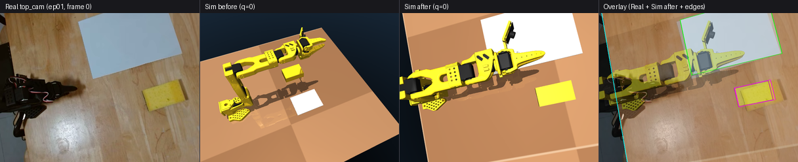

# Real-to-Sim Scene Alignment (#25 — Neon Run)

This document records the real-to-simulation alignment of
[`src/so101_classical_control/sim/assets/sponge_paper_scene.xml`](../src/so101_classical_control/sim/assets/sponge_paper_scene.xml)
to the real SO-101 desk setup for [Issue #25](https://github.com/yohei1126/so101-classical-control/issues/25)
(Orchestrator comparison Run A).

## Scope and Safety Constraints

- **In-scope XML edits**: `top_cam` (`pos`, `xyaxes`, `fovy`, and its descriptive comment), `desk` body `pos` and geom `size` (top surface kept at `z = 0.000 m`), `sponge` body `pos` and geom `size` (resting on `z = 0.000 m`), and `paper` body `pos` and geom `size` (resting on `z = 0.000 m`).
- **Out-of-scope (unchanged)**: the vendored `robotstudio_so101/so101.xml` robot model (links, joints, limits, actuators), `wrist_cam`, `desk_marker`, `ee_marker`, physics parameters (`mass`, `friction`, `<option>`, `<default>`), materials, lights, and all Python source files under `src/`.
- **Hardware safety**: cameras / recorded camera frames only; the physical SO-101 arm was never moved or connected.

## Models Used

| Role | Model Name | Model ID / Setting |
| --- | --- | --- |
| Orchestrator (planning) | Gemini 4 Neon | Antigravity `Orchestrator (Neon)` setting (exact API model id is not exposed in the agent environment) |
| Implementer (execution) | Gemini 4 Hydrogen | `gemini-4-hydrogen` (per Issue #25 specification; exact runtime model id string is not exposed in the agent environment) |

## Source Measurements and Real Top-Camera Frames

### Measured Desk and Object Sizes (Applied1 2026-10-26)

All physical dimensions come from the Applied1 2026-10-26 layout records
(`lerobot-so101-pick-and-place/docs/hardware.ja.md` L128–155 and
`port_pick_align/src/port_pick_align/simulation/table_layout.py` L16–36). Superseded layouts
from 2026-10-22 (`~134 cm` table) and 2026-10-25 (`140 x 69 cm`) were not used.

| Object | Measured Dimensions (Physical) | Sim Box Half-Size (`size` in m) | Source |
| --- | --- | --- | --- |
| Desk | 140 cm wide (Y) x 70 cm deep (X); Follower base span midpoint at 73.5 cm from left / 66.5 cm from right | `0.35 0.70 0.02` | Measured (`hardware.ja.md` L128, L152) |
| Paper (goal) | Portrait 20 cm wide (Y) x 30 cm deep (X), 2 mm modeled thickness | `0.15 0.10 0.001` | Measured (`hardware.ja.md` L135, `table_layout.py` L30–31) |
| Sponge | Portrait 6 cm wide (Y) x 11 cm deep (X), 3 cm height | `0.055 0.03 0.015` | Measured (`hardware.ja.md` L136, `table_layout.py` L35–36) |

### Top-Camera Frame Selection

Per Issue #25 Comment 2, `setup_layout39_IMG_1336.jpg`, `setup_layout39_IMG_1338.jpg`, and
`setup_layout39_combined.jpg` are external setup photographs rather than `top_cam` images, so
three `640x480` frames from the real Logitech C920 `top_cam` were extracted from the Applied1
`layout20261026` recorded dataset (`so101_pick_sponge_layout20261026_merged39_20261028`,
`videos/observation.images.top/chunk-000/file-000.mp4`, frame 0 of each episode):

| Image Set | Episode | Timestamp (`file-000.mp4`) | Notes |
| --- | --- | --- | --- |
| Set 1 | `ep01` | `25.000 s` | Idle start layout; no people or personal items |
| Set 2 | `ep05` | `125.000 s` | Idle start layout; no people or personal items |
| Set 3 | `ep10` | `245.633 s` | Idle start layout; no people or personal items |

Episode `ep00` was excluded because human hands appear at the left border of the frame.

### Empirical Geometry Findings

1. **`top_cam` vertical FOV (`fovy = 43.3°`)**: The Logitech C920 specifies a 78° diagonal FOV
   on its native 16:9 sensor, which corresponds to a 43.3° vertical FOV. In 4:3 (`640x480`)
   center-cropped streaming mode, the vertical FOV remains 43.3° rather than 52°. Fitting the
   camera pose with `fovy = 43.3°` yields a camera height of `0.628 m` above the desk, matching
   the physical mount height visible in `setup_layout39_IMG_1338.jpg`.
2. **Paper anchor in the real `layout39` frames**: In the real `top_cam` photos, the recorded
   paper distances (`69 cm` from the desk right edge, `27 cm` from the desk front edge)
   correspond to the paper's **front-right corner** (`y_corner = +0.022 m` vs `+0.025 m`
   predicted from `69 - 66.5 cm`, and `0.289 m` from the desk front edge at `x = -0.046 m`),
   placing the `20 x 30 cm` paper center at `(0.393, 0.122, 0.001)` m clear to the left of the
   Follower arm. Centering the sheet at `(0.27, +0.025)` m would have placed it underneath the
   Follower arm.

## Old vs. New Scene Values

| Element & Attribute | Old Value (`origin/main`) | New Value (`real2sim/25-neon`) | Source |
| --- | --- | --- | --- |
| `top_cam` `pos` (m) | `0.15 -0.35 0.60` | `0.348 -0.085 0.628` | Fitted to photo |
| `top_cam` `xyaxes` | `0.919145 -0.393919 0.000000 0.332593 0.776050 0.535844` | `0.964568 -0.208547 -0.161604 0.220574 0.973508 0.060246` | Fitted to photo |
| `top_cam` `fovy` (deg) | `52` | `43.3` | C920 16:9 78° diag. vertical FOV / fitted to photo |
| `desk` body `pos` (m) | `0.15 0 -0.02` | `0.304 0.035 -0.02` | `y` measured (`0.70 - 0.665`); `x` front edge fitted to photo |
| `desk` geom `size` (m) | `0.45 0.35 0.02` | `0.35 0.70 0.02` | Measured (`140 x 70 cm`) |
| `sponge` body `pos` (m) | `0.30 0.08 0.015` | `0.427 -0.085 0.015` | Fitted to photo (3-episode mean) |
| `sponge` geom `size` (m) | `0.045 0.03 0.015` | `0.055 0.03 0.015` | Measured (`6 x 11 cm` footprint, `3 cm` height) |
| `paper` body `pos` (m) | `0.30 -0.08 0.001` | `0.393 0.122 0.001` | Fitted to photo (3-episode mean) |
| `paper` geom `size` (m) | `0.06 0.045 0.001` | `0.15 0.10 0.001` | Measured (`20 x 30 cm`) |

## Visual Comparison Sets (Real / Sim Before / Sim After / Overlay)

Each figure shows four `640x480` camera views scaled to `304x228` panels (`1216x248` total):
(1) real `top_cam` frame, (2) `Sim before` (`origin/main`, `q = 0`), (3) `Sim after` (aligned scene,
`q = 0`), and (4) 45%/55% real/sim alpha overlay with projected updated geometry edges (cyan: desk
front edge, green: paper top, magenta: sponge top and bottom).

### Set 1 — `ep01` (`t = 25.000 s`)



### Set 2 — `ep05` (`t = 125.000 s`)


### Set 3 — `ep10` (`t = 245.633 s`)


### Pixel Reprojection Residuals

| Episode | Paper Corner RMSE (px) | Paper TL / BL / BR Error (px) | Sponge Center Error (px) | Desk Front Edge RMSE (px) |
| --- | --- | --- | --- | --- |
| `ep01` | `10.56` | `11.7` / `12.1` / `7.2` | `24.55` | `2.34` |
| `ep05` | `3.46` | `3.7` / `4.6` / `1.1` | `19.48` | `2.46` |
| `ep10` | `11.17` | `16.4` / `8.1` / `6.3` | `6.76` | `2.91` |

Across episodes, the static scene positions match the 3-episode average while per-episode
residuals reflect manual paper and sponge placement differences between recorded episodes.

## Comparison Against Issue #9 `top_cam` Pose and Test Verification

### Old vs. New `top_cam` Pose Difference

Comparing `get_camera_pose("top_cam")` between `origin/main` and `real2sim/25-neon`:

- **Position difference (`||p_new - p_old||`)**: `331.98 mm` (`Δpos = [+0.198, +0.265, +0.028] m`)
- **Rotation difference (geodesic angle of `R_old^T R_new`)**: `33.01 deg` (`0.576134 rad`)

### Issue #9 Calibration Recovery on the Updated Scene

Running the 24-configuration (`276` unordered pairs) Issue #9 verification against the updated
`top_cam` ground truth:

- `camera_to_base_per_pose` worst error: `6.674e-16 m`, `1.053e-16 rad`
- `solve_ax_xb` error: `2.834e-16 m`, `1.651e-16 rad`

### Test Suite and Issue #10 Noise-Sweep Regeneration

Immediately after updating `sponge_paper_scene.xml`, `uv run --frozen pytest` passed `214/215`
tests (including `test_sim_cameras.py::test_ee_marker_is_visible_from_top_cam`,
`test_eyetohand_camerabase.py`, `test_handeye_axxb.py`, `test_sim_scene.py`, and
`test_backend.py`). Only `tests/test_calibration_noise.py::test_committed_summary_matches_regeneration`
failed (`rotation_error_deg_median`: `0.440288` vs `0.430967`) because the committed Issue #10
artifacts in `results/` were tied to the pre-alignment `top_cam` pose.

No test files or tolerances were modified. Instead, the committed Issue #10 artifacts and generated
table blocks were regenerated with the repository's own CLI:

```bash
uv run --frozen python -m so101_classical_control.eval.noise_robustness
uv run --frozen python -m so101_classical_control.eval.noise_robustness --render-docs
```

This updated `results/noise_robustness_summary.csv`, `results/noise_robustness.png`,
`results/README.md`, and `docs/calibration.md`. After regeneration, both `uv run --frozen ruff check .`
and `uv run --frozen pytest` (`215 passed in 40.12s`) pass cleanly.
