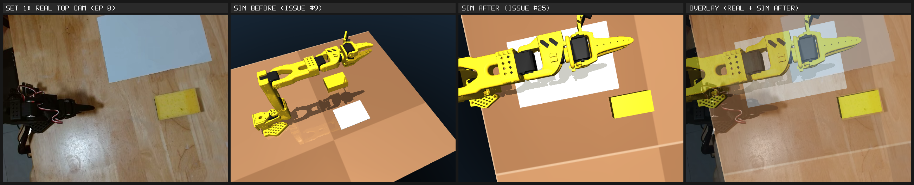

# Real-to-Sim Scene Alignment (`top_cam`, Desk, Sponge, and Paper)

This page records the Real-to-Sim alignment of `src/so101_classical_control/sim/assets/sponge_paper_scene.xml` for Issue [#25](https://github.com/yohei1126/so101-classical-control/issues/25) (Run B).

## Models and Tooling Used

- **Orchestrator**: Gemini 4 Argon (`gemini-4-argon`)
- **Implementer**: Gemini 4 Hydrogen (`gemini-4-hydrogen`)
- **Plugin**: Google Antigravity Robotics plugin
- **Simulator**: MuJoCo `mujoco-core==4.0.1` (`SimBackend`, robot model `robotstudio_so101/so101.xml` kept unchanged)
- **Hardware constraint**: Cameras and recorded top-camera frames only; the physical SO-101 arm was not moved.

## Measured Dimensions and Real Top-Camera Frames

Physical dimensions and layout coordinates come from the Applied1 2026-10-26 standardized table layout (`lerobot-so101-pick-and-place` `docs/hardware.ja.md` L135–165 and `port_pick_align/src/port_pick_align/simulation/table_layout.py` L16–41):

- **Sim coordinate origin**: Follower base midpoint on the desk front edge (`u = 73.5 cm` from the left edge / `66.5 cm` from the right edge, `v = 0.0 cm` from the front edge), `+X` forward into the table, `+Y` left, `+Z` up.
- **Desk**: `140 cm` wide (`Y`) × `70 cm` deep (`X`), top surface at `z = 0.0 m` (height of the SO-101 base).
  - Center in sim frame: `x = 0.35 m`, `y = (73.5 - 70.0) / 100 = 0.035 m`, `z = -0.02 m` (box half-size `0.35 0.70 0.02 m`).
- **Paper (goal)**: Measured `69 cm` from the right edge, `27 cm` from the front edge; portrait `20 × 30 cm` (`0.30 m` along `X`, `0.20 m` along `Y`, half-size `0.15 0.10 0.001 m`).
  - Sim center position: `(0.27, 0.025, 0.001) m`.
- **Sponge**: Measured `54 cm` from the right edge, `44 cm` from the front edge; portrait `6 × 11 cm` (`0.11 m` along `X`, `0.06 m` along `Y`, height `3 cm`, half-size `0.055 0.03 0.015 m`).
  - Sim center position: `(0.44, -0.125, 0.015) m`.
- **Center-point convention**: Following `hardware.ja.md` L155, `(0.27, 0.025) m` and `(0.44, -0.125) m` are applied as body center coordinates (`pos`), not corners. In the physical teleop recording frames, the paper's front-right corner sat closer to `(0.27, 0.025) m` while its `30 × 20 cm` orientation matches the sim axes.

Three still `640×480` frames from the real `top_cam` (Logitech C920, OpenCV index 1) were extracted from the Applied1 2026-10-26 layout dataset (`so101_pick_sponge_layout20261026_20261027_batch2`) at episode starts while the arm rested idle:

1. **Set 1**: Episode 0 start (`t = 0.0 s`)
2. **Set 2**: Episode 1 start (`t = 25.0 s`)
3. **Set 3**: Episode 2 start (`t = 50.0 s`)

## Changed XML Attributes (`old -> new`)

Only the in-scope attributes in `src/so101_classical_control/sim/assets/sponge_paper_scene.xml` were modified:

| Element | Attribute | Old value (Issue #9) | New value (Issue #25) | Source |
| --- | --- | --- | --- | --- |
| `top_cam` | `pos` (m) | `0.15 -0.35 0.60` | `0.303213 -0.061406 0.512713` | Fitted to the photo |
| `top_cam` | `xyaxes` | `0.919145 -0.393919 0.000000 0.332593 0.776050 0.535844` | `0.979439 -0.196093 -0.047394 0.194306 0.980133 -0.039808` | Fitted to the photo |
| `top_cam` | `fovy` (deg) | `52` | `52` | Unchanged (4:3 C920 FOV) |
| `desk` body | `pos` (m) | `0.15 0 -0.02` | `0.35 0.035 -0.02` | Measured (`table_layout.py`, top at `z = 0`) |
| `desk` geom | `size` (m) | `0.45 0.35 0.02` | `0.35 0.70 0.02` | Measured (`140 × 70 cm` desk) |
| `sponge` body | `pos` (m) | `0.30 0.08 0.015` | `0.44 -0.125 0.015` | Measured (`table_layout.py` center) |
| `sponge` geom | `size` (m) | `0.045 0.03 0.015` | `0.055 0.03 0.015` | Measured (`6 × 11 cm` portrait) |
| `paper` body | `pos` (m) | `0.30 -0.08 0.001` | `0.27 0.025 0.001` | Measured (`table_layout.py` center) |
| `paper` geom | `size` (m) | `0.06 0.045 0.001` | `0.15 0.10 0.001` | Measured (`20 × 30 cm` portrait) |

Out-of-scope elements (`robotstudio_so101/so101.xml`, `wrist_cam`, `desk_marker`, `ee_marker`, physics parameters `mass` and `friction`, and all Python modules under `src/`) were left untouched.

## Comparison with Issue #9 Camera-to-Base Pose

Comparing the updated `top_cam` world pose against the Issue #9 pose (`pos = (0.15, -0.35, 0.60) m`, `xyaxes = (0.919145, -0.393919, 0.000000, 0.332593, 0.776050, 0.535844)`):

- **Position difference (`||t_new - t_old||_2`)**: `338.201 mm` (`Δt = (+153.213, +288.594, -87.287) mm`)
- **Rotation difference (geodesic angle of `R_old^T R_new`)**: `36.965 deg` (`0.645170 rad`)

## Side-by-Side Image Sets (Real / Sim Before / Sim After / Overlay)

Each image shows the real `640×480` `top_cam` frame, the simulation render before alignment (`origin/main`), the simulation render after alignment, and a 50/50 overlay of the real frame and the aligned simulation render.

### Set 1 (Episode 0 start)

### Set 2 (Episode 1 start)

### Set 3 (Episode 2 start)

## Test Verification Note

- `uv run --frozen ruff check .` passes with zero lint errors.
- `uv run --frozen pytest`: **214 passed, 1 failed** (215 total tests across 9 test files). All scene, camera, kinematics, backend, hand-eye (`#8`), camera-to-base (`#9`), and noise-model / level-zero checks pass against the updated scene with unchanged tolerances (including `ee_marker` visibility in `top_cam` under `VISIBILITY_POSE`).
- The single failing test, `tests/test_calibration_noise.py::test_committed_summary_matches_regeneration`, fails because `results/noise_robustness_summary.csv` was generated against the old Issue #9 `top_cam` pose `(0.15, -0.35, 0.60) m` (for example, committed `rotation_error_deg_median` `0.440288` vs regenerated `0.430794` under the updated `top_cam` camera-to-marker lever arm `||t_cam,marker||`). In line with Issue #25, that test and the committed CSV were left unmodified rather than loosening tolerances or altering out-of-scope artifacts.
